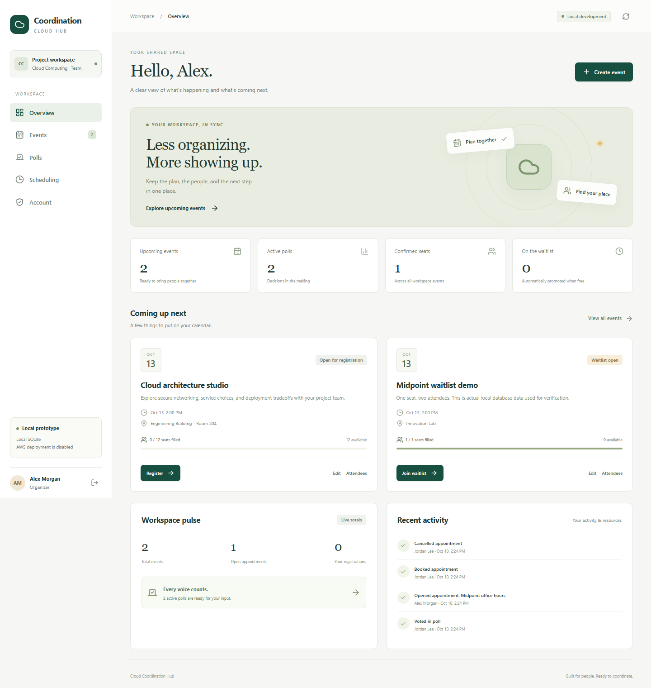
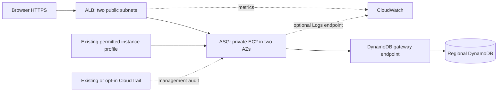

# Cloud Coordination Hub

A shared workspace for events, registrations, automatic waitlists, polls, and office-hour appointments. Built for a university AWS Cloud Computing project and its midpoint evaluation.

**Current status: functional local prototype. AWS deployment is disabled; no AWS resources have been created.** GitHub Actions performs build/test validation only. Cloud infrastructure is prepared for later authorized deployment; remote workflow results must be reviewed separately.

## Why this project

Teams often juggle forms, spreadsheets, and scheduling tools. Cloud Coordination Hub centralizes the plan and participation: organizers create opportunities, attendees reserve places or vote, and the backend handles capacity and promotion consistently.

## Implemented features

- Dashboard with stored-data totals and scoped recent activity.
- Organizer-owned events, editable capacity, confirmed registrations, FIFO waitlists, atomic cancellation/promotion and duplicate protection.
- Owner-only attendee lists and safe downloadable CSV export.
- Poll publishing, one authenticated vote per person, real results visualization and closing polls.
- Appointment slots with concurrency-safe single booking and cancellation.
- Password authentication, public attendee signup, trusted organizer provisioning, revocable database sessions and server-side ownership checks.
- Persistent local SQLite and a DynamoDB adapter with conditional transactions. SQLite is explicitly development-only.
- Responsive desktop/mobile interface, accessible forms/modals, real loading/empty/error states.
- Docker, CI verification, CloudFormation and offline-image deployment preparation.

CSV/Excel import, poll-to-event automation, editable poll drafts, multi-workspace tenancy and advanced scheduling conflict rules are final-project milestones, not functioning buttons.

## Screenshots

Actual local prototype screenshots, using SQLite-backed sample test records; **not AWS deployment evidence**:



[Mobile events screenshot](docs/screenshots/local-mobile-events.png). Recreate with `npm run test:e2e`; see [screenshot notes](docs/screenshots/README.md).

## Stack and repository

React, TypeScript, Vite, Tailwind CSS and React Router; Node **24 LTS**, Express 5, Zod, AWS SDK v3; Node SQLite for local persistence and DynamoDB for cloud; Vitest/Testing Library/Supertest and an installed-browser smoke test; Docker, GitHub Actions and CloudFormation. `package-lock.json` pins the dependency resolution. Node 24's built-in SQLite interface is experimental and confined to the local adapter.

```text
frontend/             React pages, forms, styling and API client
backend/src/          API, authentication, service logic, storage and configuration
shared/               Shared TypeScript entity and response contracts
tests/                API, concurrency, security, frontend and DynamoDB Local tests
infrastructure/       Academy-compatible CloudFormation and example parameters
scripts/              Local provisioning/seeding, verification and future release/deployment
docs/                 API, data model, security and midpoint deliverables
.github/workflows/    Build/test CI only; no deployment
```

## Start locally — no AWS or Docker required

Install Node 24, then from this repository in PowerShell:

```powershell
npm ci
# Optional: create example users and records in an EMPTY local database.
npm run demo:seed
npm run dev
```

Open **http://localhost:5173**. The seed command prints a fresh temporary password for `organizer@example.test` and `attendee@example.test`. It never writes that password to source and refuses to overwrite an existing database. Do not commit or include it in presentation evidence. Create additional attendees through the sign-up interface. If you prefer empty data, skip the seed and provision your own organizer below.

The backend listens on `127.0.0.1:3000`; Vite proxies `/api`. SQLite lives at `data/hub.sqlite` and persists across restarts. No AWS credentials are needed, requested, or looked up by this mode. Use `localhost` in the browser to match the default `APP_ORIGIN`.

Optional configuration:

```powershell
Copy-Item .env.example .env
```

Defaults work without `.env`. See the comments in [.env.example](.env.example). Keep `ALLOW_AWS=false`. For another local demo without deleting existing data, set `$env:SQLITE_PATH='./data/another-demo.sqlite'` before seeding and starting in the same terminal.

### Provision your own organizer

Use a password of 12–128 characters including uppercase, lowercase and a number. Set it in the session rather than passing it on the command line:

```powershell
$env:HUB_USER_PASSWORD = [System.Net.NetworkCredential]::new('', (Read-Host 'Organizer password' -AsSecureString)).Password
npm run user:create -- 'organizer@example.test' 'Project Organizer' organizer
Remove-Item Env:HUB_USER_PASSWORD
```

Public signup creates attendees only. Organizers can manage only their own resources. For an existing account, this command refuses duplicate creation; it does not silently replace users/passwords.

### Run the built application

```powershell
npm run build
$env:APP_ORIGIN = 'http://localhost:3000'
npm start
```

Open **http://localhost:3000**. This serves the built frontend and API from one process. `NODE_ENV` remains development for local HTTP/SQLite. `NODE_ENV=production` deliberately requires HTTPS and shared DynamoDB. If development `tsx` tooling is unavailable, compiled organizer/seed scripts are also under `dist/backend/scripts/` after the build.

## Docker and DynamoDB Local

Docker was not installed on the implementation workstation; container execution and DynamoDB Local integration are not claimed as locally verified. On a Docker-enabled workstation:

```powershell
docker compose up --build -d
# Provision organizer in the local container; enter password into this shell first.
$env:HUB_USER_PASSWORD = [System.Net.NetworkCredential]::new('', (Read-Host 'Local organizer password' -AsSecureString)).Password
docker compose exec -e HUB_USER_PASSWORD app node dist/backend/scripts/create-user.js 'organizer@example.test' 'Project Organizer' organizer
Remove-Item Env:HUB_USER_PASSWORD
```

Open **http://localhost:3000**. Compose binds services to loopback, creates a persistent DynamoDB Local volume, initializes the table, and explicitly passes dummy development credentials through the SDK. No AWS account is involved. Stop with `docker compose down`; add `--volumes` only if deliberately deleting local data.

For the API integration test alone:

```powershell
docker compose up -d dynamodb
npm run test:dynamodb
```

To run Node development against that local database, initialize it, set `DATABASE_DRIVER=dynamodb`, `DYNAMODB_ENDPOINT=http://127.0.0.1:8000`, and the matching table name, then run `npm run dev`. The UI labels this **DynamoDB Local**. The runtime image is nonroot and contains built assets and production dependencies; it never embeds development users or data.

## Tests and automation

```powershell
npm run check         # ESLint, TypeScript, tests, frontend/backend build, offline infra guards
npm run format:check
npm run test:e2e      # Installed Edge by default on Windows; no browser download
python -m pip install -r infrastructure/requirements.txt
cfn-lint infrastructure/hub.yaml
```

Set `HUB_BROWSER_PATH` to an installed Chromium-compatible executable if needed. `test:e2e` uses an isolated temporary SQLite database, starts/stops its own port-3100 server, verifies UI flows, and captures local screenshots. Regular `npm test` explicitly skips the separate DynamoDB Local integration test until `npm run test:dynamodb` is selected. [Verification](docs/midpoint/verification.md) records exactly what ran and remaining limits.

GitHub Actions installs locked dependencies, checks formatting/lint/types, runs application and local-DynamoDB tests, builds frontend/backend, validates CloudFormation and builds the Docker image. After successful main-branch CI, the existing CD workflow packages build artifacts using the same root package layout. Both workflows have read-only contents permission and do not publish an image or deploy AWS resources. Cloud deployment is not enabled.

## Prepared AWS architecture



The Academy design accepts an **existing** profile (IAM is read-only), avoids Cognito, allows only configurable t2/t3 types, caps ASG parameters at nine, and defaults to one instance with maximum two. Account-wide use including image builders must remain below the nine-instance limit. No NAT is created. Private EC2 starts a preloaded image from a prepared AMI rather than downloading Docker/package dependencies.

An existing permitted certificate/DNS and suitable instance profile/PassRole are unresolved account prerequisites. TLS is not claimed deployed. CloudWatch Logs delivery requires explicit endpoint cost opt-in plus permissions; CloudTrail creation is optional if an existing appropriate trail suffices.

**Stop before connecting/deploying.** The exact future Academy connection, offline AMI preparation, local parameter review, change-set creation/inspection, approved execution, verification and cleanup commands are in [deployment.md](docs/midpoint/deployment.md). `Deploy-ChangeSet.ps1` requires explicit `-AllowAws` and never executes a change set during creation. No IAM capabilities are required for this template. Before deployment approval, review all prerequisites and current costs; no free-tier promise is made.

## API and security

See [API routes](docs/api.md), [database design](docs/database.md), [security controls and limits](docs/security.md) and [architecture](docs/midpoint/architecture.md). Health: `/api/health`; dependency readiness: `/api/ready`. Application records/sessions reside in the database; production uses role-based AWS access. Passwords are salted/hashed, session tokens stored as hashes, and mutations enforce exact Origin. There is no development identity bypass.

## Midpoint materials and roadmap

- [Progress, risks and final roadmap](docs/midpoint/progress.md)
- [Eight-minute demo](docs/midpoint/demo-script.md)
- [Five-minute presentation](docs/midpoint/presentation-outline.md)
- [50-point rubric checklist](docs/midpoint/grading-checklist.md)
- [Actual verification record](docs/midpoint/verification.md)
- [Future deployment prerequisites and cleanup](docs/midpoint/deployment.md)

Next priorities: rehearse independent-user local flows; run container/DynamoDB Local verification where Docker is available; then, only after separate authorization, validate profile/certificate/AMI and deploy a reviewed change set. Final work adds measured two-instance reliability, recovery/performance evidence, stronger account lifecycle, pagination/workspace isolation, imports and poll-to-event workflows.

## Contributors and license

University Cloud Computing project team (three contributors; add agreed public display names through team review). No student IDs, private email addresses or AWS credentials should be published. See [LICENSE](LICENSE).
