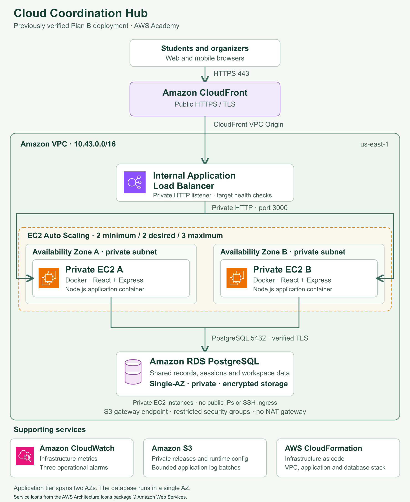
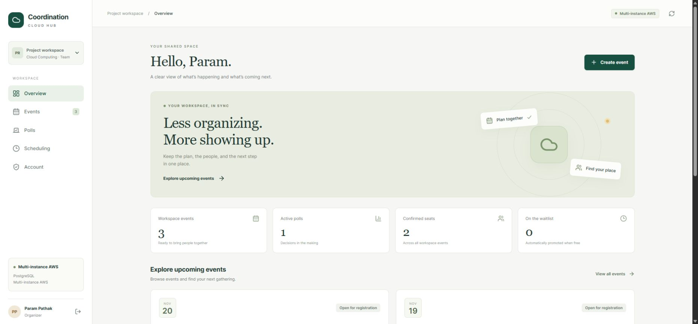
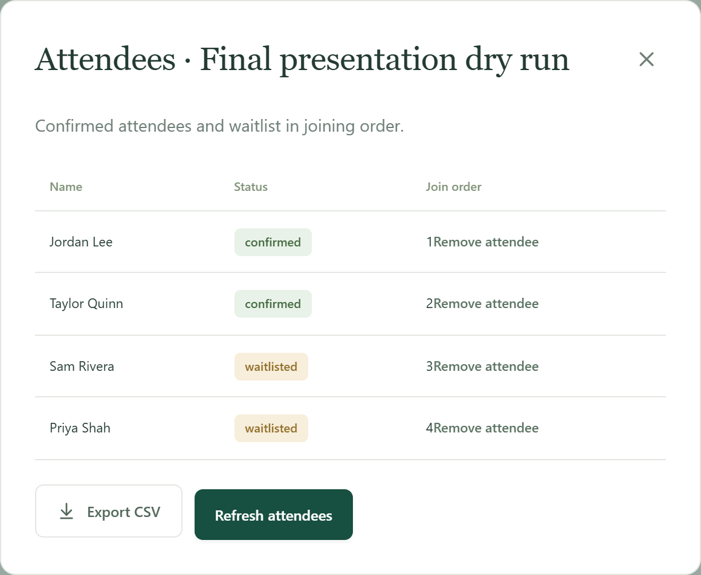
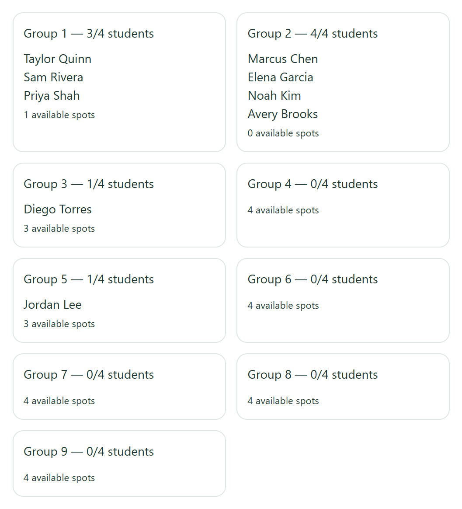

# Cloud Coordination Hub

A shared workspace for events, registrations, automatic waitlists, polls, and office-hour appointments. Built for a university AWS Cloud Computing final project.

**Project status.** Private workspaces, invitation links and QR sharing/scanning are implemented in the current source. The full Plan B architecture was deployed and verified in earlier AWS Academy sessions. Current public availability has not been reverified for this documentation update. Historical deployment evidence records the tested release and Sandbox session.

## Why this project

Teams often juggle forms, spreadsheets, and scheduling tools. Cloud Coordination Hub centralizes the plan and participation: organizers create opportunities, attendees reserve places or vote, and the backend handles capacity and promotion consistently.

## Implemented features

- Private workspaces with organizer creation, workspace switching, isolated events/polls/schedules, Owner/Manager/Attendee permissions, membership management, archive and restore operations.
- Invitation codes, shareable invitation links and downloadable QR codes, camera scanning with manual entry fallback, workspace confirmation, and invitation rotation or disabling.
- Name-only classroom guests with stored identities and revocable sessions, attendee accounts, organizer login, password hashing, and server-side authorization.
- Events with capacity limits, duplicate protection, FIFO waitlists and automatic promotion after cancellation. Grouped registration supports automatic assignment, attendee group selection, organizer membership controls and CSV exports.
- Office-hour schedules with time-zone handling, recurrence, previews, booking capacity, overlap protection, cancellation, rescheduling and organizer controls.
- Standard, multiple-choice and capacity-limited polls with voting/results, per-option limits, organizer management and deletion, and authorization checks.
- Responsive dashboards with scoped activity and stored totals. PostgreSQL supplies shared application records and sessions for Plan B, while SQLite supports local use and the single-instance fallback. The legacy DynamoDB adapter is retained as an alternative storage path.

Invitation links open the workspace joining flow and require confirmation. Camera scanning depends on HTTPS (or a supported localhost context), device support and camera permission. The repository includes the latest invitation/QR implementation. Deployment evidence applies to the release recorded in each report. [Workspace invitation details](docs/classroom-invitations.md).

Universal CSV/Excel import and export and poll-to-event automation remain future extensions.

## Verified AWS architecture



The verified Plan B deployment uses `us-east-1` and VPC `10.43.0.0/16`. The diagram represents that architecture and its recorded deployment evidence. [Editable SVG](docs/architecture.svg), [Plan B template](infrastructure/hub-postgres.json), [historical AWS verification](docs/evidence/plan-b-aws-live.json).

1. Students and organizers connect to **CloudFront over HTTPS**. A **CloudFront VPC Origin** reaches the internal Application Load Balancer over private HTTP.
2. The ALB routes requests to healthy **Dockerized React/Express applications on two private EC2 instances**, one per Availability Zone. EC2 Auto Scaling uses minimum/desired/maximum capacities of **2/2/3** and replaces unhealthy instances.
3. Both instances use the same **private, encrypted RDS PostgreSQL database**, including records, sessions and workspace data. The application verifies the database's TLS certificate. RDS uses **Single-AZ** storage and compute. The application tier spans two AZs.
4. **S3** holds private releases, runtime configuration and bounded application log batches. A gateway endpoint supplies private S3 access. **CloudWatch** provides infrastructure metrics and three alarms for unhealthy ALB targets, database CPU and database free storage.
5. **CloudFormation** defines the networking, application and database resources. Security groups restrict ALB-to-application traffic to port 3000 and application-to-database traffic to port 5432. EC2 instances have no public IPs or SSH ingress, and the design uses no NAT gateway.

The diagram reuses the existing Elastic Load Balancing, EC2 and CloudWatch service icons. [AWS architecture icon attribution](https://aws.amazon.com/architecture/icons/).

### Deployment environments and verification

| Environment                     | Architecture                                                                                           | Evidence                                                                        |
| ------------------------------- | ------------------------------------------------------------------------------------------------------ | ------------------------------------------------------------------------------- |
| Previously verified full Plan B | CloudFront VPC Origin, internal ALB, two private EC2 instances, Auto Scaling and shared RDS PostgreSQL | Historical AWS resource checks, functional verification and a 50-guest workload |
| Separate classroom fallback     | CloudFront HTTPS, one EC2 instance and SQLite, with its own demo accounts and records                  | Independently verified classroom presentation workflows                         |
| Local development               | React/Express with SQLite, with separate PostgreSQL and legacy DynamoDB test paths                     | Local feature, storage and concurrency checks                                   |

Academy deployments and their HTTPS addresses depend on the active Sandbox session. This README does not advertise a current public demo URL. The historical handoff records the full architecture and its operating limits. [Classroom deployment evidence](docs/classroom-deployment-status.md), [workspace migration and release handoff](docs/multi-workspace-deployment-handoff.md).

The historical AWS workload used **50 independent guest identities** and **452 HTTP requests**. All **384 valid requests succeeded**, with **66 expected HTTP 409 business conflicts**, two deliberate authorization checks and **zero unexpected server errors**. API p50/p95/p99 were **124/708/877 ms**, and each EC2 instance processed 226 requests. These measurements describe that recorded deployment and release. Earlier local SQLite/DynamoDB measurements have their own verification report. [AWS test evidence](docs/classroom-deployment-status.md#live-50-student-workload), [local test history](docs/final-verification.md).

Grouped events, office-hour scheduling and polls use version-checked transactions to enforce capacity and preserve existing participation when a conflicting change is rejected. Both application instances share database-backed sessions. Private logical exports support SQLite-to-PostgreSQL recovery, with comparison before conditional imports. [Database and migration details](docs/plan-b-preparation.md).

Create grouped events through **Events → Create event → Groups (optional)**. Group capacity replaces the ordinary event capacity with count × students/group. Confirmed attendees can view/join/change/leave groups when enabled; owners move students, remove attendees and export membership. Failed transfers preserve the old assignment.

Use **Scheduling → Create office-hour schedule** to preview a local date/time window, zone, duration, capacity, break, buffer and weekly repeats. A 2–4 PM window with 15 minutes yields eight slots. Students can provide a reason, book, cancel or atomically reschedule. Owners inspect students/reasons and cancel or block appointments. Unknown legacy timestamps stay unknown. Ambiguous/nonexistent DST times are rejected. Limits: 64 appointments/schedule, 500 upcoming organizer intervals, 8 weekly occurrences. Bulk schedule editing, organizer-driven relocation of another student's booking and universal spreadsheet imports are not implemented; block an available original slot and create a replacement, or explicitly resolve confirmed bookings.

The safe local seed now includes a sample office-hour schedule, 9×4 grouped event, event and poll. It refuses populated storage and AWS tables. For production, provision a unique organizer through the trusted CLI and create sample resources through that account; never publish administrator passwords.

For SQLite recovery, stop application writes and export to a private, unused backup path. Review the target database settings and comparison before applying an import.

```powershell
npm run data:migrate -- export ./data/hub.sqlite ./artifacts/private-backup.json
# Configure the intended PostgreSQL target and verified TLS as documented.
npm run data:migrate -- import ./artifacts/private-backup.json
$env:ALLOW_DATA_IMPORT = 'true'
npm run data:migrate -- import ./artifacts/private-backup.json --apply
Remove-Item Env:ALLOW_DATA_IMPORT
```

Import is comparison-only by default. Applied batches insert conditionally and resume safely; existing differing records and the SQLite source are never overwritten. Keep backups private: they contain personal information/password hashes. Migration tests verify export preservation, idempotency and conflict refusal.

## Screenshots

Organizer dashboard and Project workspace controls, captured during the previously verified Plan B deployment.



Organizer roster with confirmed attendees and the event waitlist, extracted from the supplied presentation.



Group memberships and remaining seats from the presentation's nine-group registration example.



These genuine captures show the application interface and sample records from their original sessions. Capture sources and release context are recorded in the screenshot notes. [Screenshot provenance](docs/screenshots/README.md).

## Stack and repository

React, TypeScript, Vite, Tailwind CSS and React Router run the frontend. Node **24 LTS**, Express 5 and Zod run the API. RDS PostgreSQL supplies shared Plan B persistence, SQLite supports local and single-instance use, and the legacy DynamoDB adapter remains available. Vitest, Testing Library and Supertest cover application behavior. Docker packages the application, CloudFormation defines AWS resources, and GitHub Actions checks and packages releases. `package-lock.json` pins dependencies.

```text
frontend/             React pages, forms, styling and API client
backend/src/          API, authentication, service logic, storage and configuration
shared/               Shared TypeScript entity and response contracts
tests/                API, concurrency, security, frontend and DynamoDB Local tests
infrastructure/       Academy-compatible CloudFormation and example parameters
scripts/              Local provisioning/seeding, verification and release/deployment
docs/                 API, data model, security and midpoint deliverables
.github/workflows/    Build/test CI only; no deployment
```

## Start locally — no AWS or Docker required

Install Node 24, then from this repository in PowerShell:

```powershell
npm ci
# Optional: create example users and records in an EMPTY local database.
npm run demo:seed
npm run dev
```

Open **http://localhost:5173**. The seed command prints a fresh temporary password for `organizer@example.test` and `attendee@example.test`. It never writes that password to source and refuses to overwrite an existing database. Do not commit or include it in presentation evidence. Create additional attendees through the sign-up interface. If you prefer empty data, skip the seed and provision your own organizer below.

The backend listens on `127.0.0.1:3000`; Vite proxies `/api`. SQLite lives at `data/hub.sqlite` and persists across restarts. Relative `SQLITE_PATH` values resolve from the application package root for both seeding and the server; each prints its resolved database path. No AWS credentials are needed, requested, or looked up by this mode. Local development permits both `localhost` and `127.0.0.1` on the API port (default 3000) and Vite port 5173. Production requires the exact configured `APP_ORIGIN`, with HTTPS by default and the documented explicit classroom HTTP exception.

Optional configuration:

```powershell
Copy-Item .env.example .env
```

Defaults work without `.env`. See the comments in [.env.example](.env.example). Keep `ALLOW_AWS=false`. For another local demo without deleting existing data, set `$env:SQLITE_PATH='./data/another-demo.sqlite'` before seeding and starting in the same terminal.

Private workspaces require the explicit workspace migration for a seeded or existing database. Select the Project workspace owner, review the dry run and apply while writers are stopped, following the documented SQLite procedure. [Workspace migration steps](docs/multi-workspace-deployment-handoff.md#dry-run-and-migration).

### Provision your own organizer

Use a password of 12–128 characters including uppercase, lowercase and a number. Set it in the session rather than passing it on the command line:

```powershell
$env:HUB_USER_PASSWORD = [System.Net.NetworkCredential]::new('', (Read-Host 'Organizer password' -AsSecureString)).Password
npm run user:create -- 'organizer@example.test' 'Project Organizer' organizer
Remove-Item Env:HUB_USER_PASSWORD
```

Public signup creates attendees only. Workspace Owners and Managers manage their workspace resources, and attendees manage their own participation. For an existing account, this command refuses duplicate creation; it does not silently replace users/passwords.

### Run the built application

```powershell
npm run build
$env:APP_ORIGIN = 'http://localhost:3000'
npm start
```

Open **http://localhost:3000**. This serves the built frontend and API from one process. `NODE_ENV` remains development for local HTTP/SQLite. `NODE_ENV=production` supports persistent SQLite on one instance or a configured shared PostgreSQL/DynamoDB adapter. The verified Plan B uses PostgreSQL with certificate-verified TLS. HTTPS is the default; disposable classroom HTTP requires explicit `ALLOW_INSECURE_HTTP=true` with SQLite. If development `tsx` tooling is unavailable, compiled organizer/seed scripts are also under `dist/backend/scripts/` after the build.

## Poll management

Create a poll from **Polls > Create poll**. Standard voting remains the default. Select **Capacity-limited signup** to set a capacity for each topic, or **Multiple choice** to set a maximum and optional topic capacities (blank means unlimited). Capacity signups identify participants; ordinary polls are anonymous by default. Advanced settings control organizer voting (disabled for new polls), changes, cancellation, result visibility and draft creation.

**Manage poll** is available to authorized workspace organizers and trusted administrators within their workspace access. Open/close/archive polls, edit settings/capacities, and search/filter/sort/page through identified participants. Removing a participant requires confirmation and cancels all their active selections, releasing places. Capacity reductions below confirmed signups and unsafe option/type/anonymity/selection-limit edits are rejected. Anonymous polls provide aggregate management only. Closed polls can reopen; archived polls preserve history and cannot reopen. Exports for polls are scheduled for Stage 4.

Workspace membership scopes access to poll management. Trusted administrator accounts are provisioned through the existing CLI:

```powershell
$env:HUB_USER_PASSWORD = [System.Net.NetworkCredential]::new('', (Read-Host 'Administrator password' -AsSecureString)).Password
npm run user:create -- 'admin@example.test' 'Campus Admin' admin
Remove-Item Env:HUB_USER_PASSWORD
```

SQLite runs migration `001-polls` automatically when the application next opens the database. Before upgrading an existing database, stop the backend and copy the complete SQLite database safely to a backup. Existing votes, IDs, ownership and closed state remain intact; legacy polls retain organizer voting and existing result visibility. Missing historical vote timestamps remain unknown. This implementation has not opened or migrated your live `data/hub.sqlite`. Recovery: stop the backend, retain the current database/WAL files separately, restore the verified pre-upgrade backup, and use the previous application version; do not overwrite new data without review.

Legacy DynamoDB polls are read compatibly and upgraded on mutation. For an explicit, resumable migration on a configured **local** DynamoDB database:

```powershell
node --import tsx scripts/migrate-polls.ts
```

The command also works with SQLite (which migrates when opened). No AWS connection/deployment is needed or performed. Polls remain bounded to 2-8 options, 2,000 active participants, 4,000 stored historical selections, and a 290 KB mutation limit. Server transactions enforce capacity and atomic switching; a full destination leaves the original registration intact. Multiple-choice percentages are per participant and can sum above 100%.

To check the feature, use separate organizer/student/admin sessions: publish a signup with capacity one, fill it, verify the full state in another student session, cancel and rebook, try switching to a full topic, inspect participants as owner/admin, and verify unrelated users cannot access the list. Run `npm run check`, `npm run format:check`, and `npm run test:e2e`; run `npm run test:dynamodb` when DynamoDB Local is available. Office-hour scheduling and grouped events are now implemented; see [final verification](docs/final-verification.md).

## Docker and DynamoDB Local

Docker packaging was exercised in the recorded AWS deployment. For a local DynamoDB environment on a Docker-enabled workstation:

```powershell
docker compose up --build -d
# Provision organizer in the local container; enter password into this shell first.
$env:HUB_USER_PASSWORD = [System.Net.NetworkCredential]::new('', (Read-Host 'Local organizer password' -AsSecureString)).Password
docker compose exec -e HUB_USER_PASSWORD app node dist/backend/scripts/create-user.js 'organizer@example.test' 'Project Organizer' organizer
Remove-Item Env:HUB_USER_PASSWORD
```

Open **http://localhost:3000**. Compose binds services to loopback, creates a persistent DynamoDB Local volume, initializes the table, and explicitly passes dummy development credentials through the SDK. No AWS account is involved. Stop with `docker compose down`; add `--volumes` only if deliberately deleting local data.

For the API integration test alone:

```powershell
docker compose up -d dynamodb
npm run test:dynamodb
```

To run Node development against that local database, initialize it, set `DATABASE_DRIVER=dynamodb`, `DYNAMODB_ENDPOINT=http://127.0.0.1:8000`, and the matching table name, then run `npm run dev`. The UI labels this **DynamoDB Local**. The runtime image is nonroot and contains built assets and production dependencies; it never embeds development users or data.

## Tests and automation

```powershell
npm run check         # ESLint, TypeScript, tests, frontend/backend build, offline infra guards
npm run format:check
npm run test:e2e      # Installed Edge by default on Windows; no browser download
python -m pip install -r infrastructure/requirements.txt
cfn-lint infrastructure/hub.yaml
```

Set `HUB_BROWSER_PATH` to an installed Chromium-compatible executable if needed. `test:e2e` uses an isolated temporary SQLite database, starts/stops its own port-3100 server, verifies UI flows, and captures local screenshots. Regular `npm test` explicitly skips the separate DynamoDB Local integration test until `npm run test:dynamodb` is selected. [Verification](docs/midpoint/verification.md) records exactly what ran and remaining limits.

GitHub Actions installs locked dependencies, checks formatting/lint/types, runs application and local-DynamoDB tests, builds frontend/backend, validates CloudFormation and builds the Docker image. After successful main-branch CI, the existing CD workflow packages build artifacts using the same root package layout. Both workflows use read-only contents permission. AWS deployment follows the separately approved CloudFormation workflow.

## Single-EC2 classroom fallback

A separate AWS Academy classroom environment used CloudFront HTTPS, one EC2 instance and SQLite with fresh demonstration accounts and records. Its resources and data were independent of the full Plan B deployment. The older Ubuntu/Nginx/systemd recipe remains available as a historical single-instance prototype. [Original EC2 preparation](docs/AWS_EC2_DEPLOYMENT.md).

Added commands: `npm run start:production` enforces production validation; `npm run test:production` builds and verifies production serving, authentication, origin checks, demo seed safeguards and data/session persistence across a process restart. `npm run user:create:built` and `npm run demo:seed:built` use compiled CLI files after building. Production demo seeding requires an explicit `ALLOW_DEMO_SEED=true` and empty SQLite storage. Existing development scripts are unchanged.

See [demo checklist](docs/AWS_DEMO_CHECKLIST.md), [troubleshooting](docs/AWS_TROUBLESHOOTING.md), and [preparation verification](docs/DEPLOYMENT_VERIFICATION.md). The optional `infrastructure/single-ec2.yaml` prepares one instance/security group only; account-specific Sandbox permissions must be checked manually.

## Deployment references

The full Plan B uses the PostgreSQL template and private S3 bootstrap. Deployment procedures, release checks and recovery requirements are documented separately from the local development workflow. Academy permissions, quotas, session duration and costs require review for each deployment. [Plan B template](infrastructure/hub-postgres.json), [recovery procedure](docs/plan-b-recovery.md), [release handoff](docs/frontend-release-handoff.md).

The earlier DynamoDB CloudFormation design and midpoint materials remain as project history and alternative infrastructure. [Legacy DynamoDB template](infrastructure/hub.yaml), [midpoint deployment notes](docs/midpoint/deployment.md).

## API and security

See [API routes](docs/api.md), [database design](docs/database.md), [security controls and limits](docs/security.md) and the [Plan B architecture](#verified-aws-architecture). Health: `/api/health`; dependency readiness: `/api/ready`. Application records/sessions reside in the database; the optional DynamoDB deployment uses role-based AWS access; the single-instance SQLite deployment does not access AWS APIs. Passwords are salted/hashed, session tokens stored as hashes, and mutations enforce an explicit origin allowlist (exact origin in production). There is no development identity bypass.

## Midpoint history and remaining work

- [Progress, risks and final roadmap](docs/midpoint/progress.md)
- [Eight-minute demo](docs/midpoint/demo-script.md)
- [Five-minute presentation](docs/midpoint/presentation-outline.md)
- [50-point rubric checklist](docs/midpoint/grading-checklist.md)
- [Actual verification record](docs/midpoint/verification.md)
- [Future deployment prerequisites and cleanup](docs/midpoint/deployment.md)

The linked midpoint deliverables describe earlier project stages. Remaining extensions include universal spreadsheet imports, poll-to-event workflows, email delivery, password recovery and database Multi-AZ failover. Private workspaces, scoped queries and workspace access isolation are implemented.

## Contributors and license

University Cloud Computing project team (three contributors; add agreed public display names through team review). No student IDs, private email addresses or AWS credentials should be published. See [LICENSE](LICENSE).

## November 13 reliability and query update

The active UI now uses bounded resource pages and transactional summary counts instead of repeatedly downloading the workspace. See [optimization verification](docs/optimization-verification.md) for current measurements, test evidence, migration prerequisites and limitations. This report preserves the earlier local test measurements and their original context.

Set `DEPLOYMENT_MODE=local`, `ec2`, or `aws-multi` independently of database technology. Multi-instance AWS requires a shared database. Plan B uses PostgreSQL. The legacy DynamoDB path rejects a local endpoint in this mode. EC2 examples and the multi-AZ template set their respective deployment modes explicitly. `/api/health` exposes only the mode, database label and configured HTTPS status.

SQLite expired-session maintenance runs once at startup and every `SESSION_CLEANUP_SECONDS` (default 900, minimum 60); shutdown clears its timer. DynamoDB still uses TTL and authentication always checks expiry.

**Upgrade prerequisite:** stop all DynamoDB writers and back up the table before rebuilding counters. Preview with `npx tsx scripts/rebuild-summary.ts`; after independently confirming writers are stopped, set `ALLOW_SUMMARY_REBUILD=true` and run it with `--apply`. Remove the environment variable afterward. Existing uninitialized tables fail readiness rather than publishing invented totals. New empty tables initialize automatically. SQLite builds its summary once from existing records and maintains it transactionally. Never mix old writers with this release.

Optional appointment downloads are `.ics` snapshots, not email invitations or reminders. Delete an old calendar entry after cancellation/rescheduling and download the replacement. No email delivery or password-reset service is claimed.

Additional local query commands include `npx tsx scripts/query-benchmark.ts` and `HUB_LOAD_MODE=legacy` / `HUB_LOAD_MODE=paginated` with `test:load` (PowerShell: set `$env:HUB_LOAD_MODE`). Loads accept only isolated local databases, not production targets.
