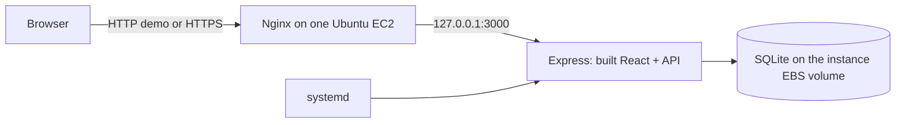

# Single Ubuntu EC2 deployment

This is a manual deployment plan, not evidence of an AWS deployment. No AWS credentials are required by the application. Use one Ubuntu 24.04 LTS instance, Nginx, Node 24, and persistent SQLite. The existing ALB/ASG/DynamoDB template remains an alternative; **do not deploy `infrastructure/hub.yaml` for this demo**. No GitHub Actions deployment is added or enabled.



## 1. Review and transfer the prepared repository

The preparation is local; it has not been pushed. Review the changes before deployment. You can commit/push them yourself, then clone your chosen branch on EC2, or upload a source archive containing these changes. Cloning the unchanged GitHub main branch will not include this preparation. Never upload `node_modules`, `.env`, keys, or your development database.

On **Windows PowerShell**, from the prepared checkout, create a source archive without pushing:

```powershell
git status --short
# Stage only the reviewed preparation files. Review git diff --cached before continuing.
git add .env.example .gitattributes .gitignore .github/workflows/ci.yml package.json backend/src/config.ts backend/src/app.ts backend/src/server.ts backend/src/demo-data.ts scripts/seed.ts scripts/start-production.mjs scripts/deploy-ec2.sh scripts/production-smoke.mjs deployment infrastructure/single-ec2.yaml tests/backend.test.ts docs/AWS_EC2_DEPLOYMENT.md docs/AWS_DEMO_CHECKLIST.md docs/AWS_TROUBLESHOOTING.md docs/DEPLOYMENT_VERIFICATION.md README.md docs/security.md docs/database.md
git diff --cached --stat
# git write-tree records the staged snapshot locally; it neither commits nor pushes.
$snapshot = git write-tree
git archive --format=tar.gz --output=../cloud-coordination-hub-source.tar.gz $snapshot
```

## 2. Launch manually in AWS Academy Sandbox

Start Lab and wait until AWS is ready. Read **your Sandbox's** allowed services, instance types, remaining $20 budget, and End Lab/reset policy. Nothing here proves those permissions. Open EC2 in the assigned region. Choose Launch instance:

- Name: `cloud-coordination-hub-demo`.
- Official Canonical Ubuntu Server **24.04 LTS amd64** AMI; verify publisher/region, not an arbitrary marketplace image.
- One permitted `t3.micro` (1 GiB RAM) or `t3.small` (2 GiB RAM if the budget permits). Select **Standard CPU credits** for T3 to avoid Unlimited surplus credit charges. Check your Sandbox restrictions; do not assume every instance type is allowed.
- Existing VPC and a **public subnet with `0.0.0.0/0` routed to an Internet Gateway**. Auto-assign public IPv4 enabled. Do not create a NAT gateway.
- SSH key pair you control. Keep the downloaded private key outside the repository.
- Security group: TCP 22 from **your public IPv4/32**, TCP 80 for the temporary demo, TCP 443 if you configure TLS. Never open 3000, 5173, or a database port publicly. You may restrict 80/443 to your classroom IP ranges instead.
- One encrypted 16 GiB gp3 root EBS volume. No instance profile, RDS, DynamoDB, ALB, or additional instances required. IMDSv2 required.

Wait for Running and both status checks. Copy Public IPv4. Optional CloudFormation: upload **`infrastructure/single-ec2.yaml`** in the console and supply the verified AMI, existing VPC/subnet, key pair, and your SSH `/32`; inspect changes before creating. It creates exactly one instance and one security group, with no IAM. The template configures Standard CPU credits for T3. If CloudFormation is denied, use the manual launch above. The template does not install the application and permissions were not checked against your account.

## 3. Connect and upload (Windows PowerShell)

```powershell
$Ec2Ip = 'REPLACE_WITH_PUBLIC_IP'
$Key = 'C:\Users\Param\Downloads\REPLACE_WITH_KEY.pem'
# Restrict this file to your Windows user if SSH reports insecure key permissions.
icacls $Key /inheritance:r
icacls $Key /grant:r "$($env:USERNAME):(R)"
ssh -i $Key "ubuntu@$Ec2Ip"
```

Verify the SSH host fingerprint through a trusted channel before accepting it. To transfer the prepared archive, use a **second PowerShell window**:

```powershell
scp -i $Key ..\cloud-coordination-hub-source.tar.gz "ubuntu@${Ec2Ip}:/home/ubuntu/"
```

## 4. Prepare source and configuration (Ubuntu SSH terminal)

```bash
sudo apt-get update
sudo apt-get install -y git ca-certificates curl nginx
mkdir -p ~/cloud-coordination-hub
tar -xzf ~/cloud-coordination-hub-source.tar.gz -C ~/cloud-coordination-hub
cd ~/cloud-coordination-hub
# An archive needs a Git index for the deployment source snapshot.
git init
git add .
```

Alternatively, **after you personally push the reviewed changes**, clone your selected branch instead of extracting the archive:

```bash
git clone --branch YOUR_REVIEWED_BRANCH https://github.com/ParampPathak/Cloud-Coordination-Hub.git ~/cloud-coordination-hub
cd ~/cloud-coordination-hub
```

Create the external environment file only if it does not exist; never overwrite an existing configuration on updates:

```bash
if ! sudo test -e /etc/cloud-coordination-hub.env; then
  sudo install -m 0600 deployment/ec2.env.example /etc/cloud-coordination-hub.env
fi
sudo nano /etc/cloud-coordination-hub.env
```

Set these values manually:

| Variable              | Demo value / purpose                                                                         |
| --------------------- | -------------------------------------------------------------------------------------------- |
| `NODE_ENV`            | `production`                                                                                 |
| `HOST`                | `127.0.0.1` (only local Nginx reaches Node)                                                  |
| `PORT`                | `3000`; if changed, change Nginx's upstream too                                              |
| `APP_ORIGIN`          | `http://YOUR_PUBLIC_IP`, exact browser origin, no path                                       |
| `ALLOW_INSECURE_HTTP` | `true` only for disposable classroom HTTP data; otherwise `false`                            |
| `DATABASE_DRIVER`     | `sqlite`                                                                                     |
| `SQLITE_PATH`         | `/var/lib/cloud-coordination-hub/hub.sqlite`; another file below this directory is supported |
| `ALLOW_AWS`           | `false`; no AWS credential/metadata lookup in SQLite mode                                    |

Do not add `VITE_` secrets; those become browser code. Authentication uses randomly generated database-backed sessions, not a committed signing key. Organizer passwords are entered separately and never belong in this file.

## 5. Build, install and start (Ubuntu SSH terminal)

```bash
cd ~/cloud-coordination-hub
sudo bash scripts/deploy-ec2.sh
sudo systemctl status cloud-coordination-hub --no-pager
curl --fail http://127.0.0.1:3000/api/ready
```

The script installs basic Ubuntu packages and official Node 24 binaries under `/opt/cloud-coordination-hub/node`, verifies the archive checksum, creates the nonlogin `hub` account, snapshots source to a new release, installs locked dependencies, builds, runs tests, and removes development dependencies. Build/test execution is unprivileged. It validates production configuration before stopping an old app, takes a SQLite backup, switches `current`, installs/enables systemd, and checks readiness. Failed activation restores the previous code release where available. It never deletes/replaces the database or restores data automatically. Builds happen before the running release is touched. No migrations are introduced; future schema changes require a separate migration/rollback plan. Releases and backups are deliberately retained; monitor disk space and remove only old reviewed copies.

One GiB machines may run out of RAM during `npm ci`/TypeScript/Vite. Either use a permitted small instance or add a temporary swap file **only if one does not already exist**:

```bash
if ! sudo test -e /swapfile; then
  sudo fallocate -l 1G /swapfile
  sudo chmod 600 /swapfile
  sudo mkswap /swapfile
  sudo swapon /swapfile
fi
free -h
# Re-enable an existing swapfile after reboot if needed: sudo swapon /swapfile
```

This uses EBS space; it is not a substitute for sizing or a tested performance guarantee.

## 6. Configure Nginx (Ubuntu SSH terminal)

```bash
cd ~/cloud-coordination-hub
sudo install -m 0644 deployment/nginx.conf.example /etc/nginx/sites-available/cloud-coordination-hub
sudo nano /etc/nginx/sites-available/cloud-coordination-hub
# Replace hub.example.test with your public IP or DNS, and match the PORT upstream.
sudo ln -sfn /etc/nginx/sites-available/cloud-coordination-hub /etc/nginx/sites-enabled/cloud-coordination-hub
# Fresh dedicated classroom instance only; preserve other sites on shared machines.
sudo rm -f /etc/nginx/sites-enabled/default
sudo nginx -t
sudo systemctl enable nginx
sudo systemctl reload nginx
curl --fail -H 'Host: YOUR_PUBLIC_IP' http://127.0.0.1/api/health
```

Open `http://YOUR_PUBLIC_IP` from Windows. Nginx proxies **both** the React assets and `/api` to Express; Vite does not run in production. The frontend already uses relative `/api` URLs. The proxy overwrites forwarding headers; Express trusts loopback proxies for the SQLite deployment. Systemd runs one Node process directly, loads the external environment, restricts filesystem writes to the state directory, restarts failures, and starts automatically on boot. No PM2 or second application process is needed.

HTTP is an explicitly opted-in presentation compromise: passwords, cookies and data can be read/modified on the network. Use generated demo credentials only, never reused passwords or sensitive information. HttpOnly, SameSite, session expiry, authorization, CSRF origin checks and password hashing still apply. Secure cookies, HSTS and automatic asset upgrades are enabled for HTTPS; the HTTP demo cannot truthfully provide transport confidentiality.

For longer use, configure your domain/DNS and a valid TLS certificate on Nginx (e.g. an approved ACME client), redirect port 80 to 443, set `APP_ORIGIN=https://your-domain`, set `ALLOW_INSECURE_HTTP=false`, validate Nginx, restart the app and sign in again. You must obtain/install the certificate manually; no certificate/AWS service availability is assumed. See [Nginx proxy documentation](https://nginx.org/en/docs/http/ngx_http_proxy_module.html) and [systemd execution settings](https://www.freedesktop.org/software/systemd/man/latest/systemd.exec.html).

## 7. Seed the classroom demo (Ubuntu SSH terminal)

Seed once, on an **empty SQLite database**. This is never done automatically during deployment. The generated password is printed only in your interactive SSH terminal; do not redirect it to logs or publish screenshots containing it.

For classroom initialization, explicitly opt in for this one command:

```bash
cd /opt/cloud-coordination-hub/current
sudo -u hub env ALLOW_DEMO_SEED=true /opt/cloud-coordination-hub/node/bin/node \
  --env-file=/etc/cloud-coordination-hub.env dist/backend/scripts/seed.js
```

Log in as `organizer@example.test` or `attendee@example.test` using the printed temporary password. Seed logic creates two users, events, a poll, a registration/vote and an office-hour slot; it refuses a database containing any known application records. Additional registration/waitlist demo data are created through the UI. If populated, keep it and use existing credentials; to rehearse a fresh dataset, stop the service, back up the old database, change `SQLITE_PATH` to a **new filename** in the same state directory, restart, and explicitly seed that new database. No automatic deletion or password reset is performed. Do not use demo seeding with DynamoDB cloud storage.

For your own organizer without seeding:

```bash
cd /opt/cloud-coordination-hub/current
read -rsp 'Organizer password: ' HUB_USER_PASSWORD; echo
export HUB_USER_PASSWORD
sudo --preserve-env=HUB_USER_PASSWORD -u hub /opt/cloud-coordination-hub/node/bin/node \
  --env-file=/etc/cloud-coordination-hub.env dist/backend/scripts/create-user.js \
  organizer@example.test 'Project Organizer' organizer
unset HUB_USER_PASSWORD
```

## 8. Restart, update and recover

```bash
sudo systemctl restart cloud-coordination-hub
sudo journalctl -u cloud-coordination-hub -n 50 --no-pager
curl --fail http://127.0.0.1:3000/api/ready
# Updates, if the checkout follows your reviewed GitHub branch:
cd ~/cloud-coordination-hub
git status --short
git pull --ff-only
sudo bash scripts/deploy-ec2.sh
```

Archive deployments: upload a new reviewed archive to a new source directory, extract, `git init && git add .`, and run its deployment script. Do not mix an archive snapshot with a GitHub clone or overwrite your environment/data. No CD workflow or repository secrets need configuring.

SQLite, users, event records and sessions persist through service/release restarts because storage is outside the release. Persistence through an EC2 **stop/start** requires the EBS volume to survive; it does not survive instance termination or an Academy reset that deletes storage. After starting the lab tomorrow, inspect whether your instance/volume still exists. Start the stopped instance if needed, wait for status checks, copy its current public IP, update `APP_ORIGIN` and Nginx `server_name` if changed, then `sudo nginx -t && sudo systemctl reload nginx` and restart the app. Do not assume End Lab preserves or deletes resources. If reset removed them, launch a new instance, repeat setup and seed a new database or restore your private backup.

Create a consistent backup, then download it privately before stopping/ending the lab:

```bash
sudo install -d -m 0700 /opt/cloud-coordination-hub/backups
sudo sqlite3 /var/lib/cloud-coordination-hub/hub.sqlite \
  ".backup '/opt/cloud-coordination-hub/backups/manual.sqlite'"
sudo install -o ubuntu -g ubuntu -m 0600 /opt/cloud-coordination-hub/backups/manual.sqlite /home/ubuntu/hub-backup.sqlite
```

**Windows PowerShell:**

```powershell
scp -i $Key "ubuntu@${Ec2Ip}:/home/ubuntu/hub-backup.sqlite" "$env:USERPROFILE\Downloads\hub-backup.sqlite"
```

Keep backups out of Git. Restore only intentionally with the service stopped, preserve the old file/WAL sidecars first, install the backup as `hub:hub` mode 0600 to the configured path, then restart and verify login and records. Never copy only an actively written main SQLite file; use `.backup`. A single server is a single point of failure and cannot provide multi-instance availability.

## Costs and shutdown

Planning example for Linux `t3.micro` in us-east-1: about $0.0104/hour compute, $0.005/hour public IPv4, and 16 GiB gp3 at about $0.08/GiB-month ($1.28/month). Eight hours of compute plus IPv4 is about $0.123; storage adds about $0.014 for eight hours using a 730-hour month. A continuously running 730-hour month is about $12.52 before transfer, snapshots, taxes or CPU surplus credits. These are estimates, not a quote or guaranteed free tier; confirm assigned-region prices and Academy budget rules before launch. Sources: [EC2 T3 pricing](https://aws.amazon.com/ec2/instance-types/t3/), [VPC IPv4 pricing](https://aws.amazon.com/vpc/pricing/), [EBS pricing](https://aws.amazon.com/ebs/pricing/).

After practice, back up data and **Stop** EC2 in the console. Stopping the app alone does not stop EC2 charges. EBS volumes and snapshots continue costing money; retained Elastic IPs can also cost money. Avoid reserving an Elastic IP for this demo. After final grading and backup, intentionally terminate/delete the classroom resources you created and inspect leftover volumes/snapshots/addresses. The optional template's root volume has `DeleteOnTermination=true`: deleting its stack/instance destroys that database volume. Read your specific End Lab instructions and check the remaining budget. No shutdown, spending or provisioning was executed during repository preparation.

## Validation boundaries

See [local verification](DEPLOYMENT_VERIFICATION.md), [presentation checklist](AWS_DEMO_CHECKLIST.md), and [troubleshooting](AWS_TROUBLESHOOTING.md). Windows tests do not prove Ubuntu package installation, systemd, Nginx, cloud permissions or public reachability. Verify those steps on your instance before presenting.
