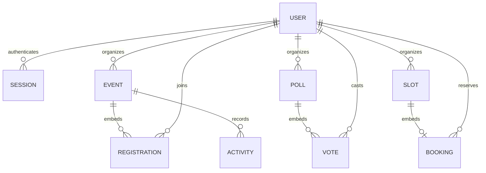

# Database model and consistency

The local default is a **persistent SQLite database**, not DynamoDB and not an in-memory fake. Node 24's built-in SQLite interface is still experimental in that LTS series; the classroom single-instance EC2 path accepts this runtime limitation; it must be evaluated before broader use. No external database installation is required. Docker Compose provides a second, AWS-compatible mode using **DynamoDB Local**. The single-instance EC2 path uses persistent SQLite under `/var/lib/cloud-coordination-hub`, outside versioned releases. The alternative multi-instance cloud deployment uses Amazon DynamoDB through AWS SDK v3 and an EC2 instance role, after separate authorization.

Both adapters expose strongly consistent `get`, paginated entity queries, conditional `put`, and removal. SQLite uses a `(kind,id)` primary key, JSON data, integer version, WAL, and a five-second busy timeout. DynamoDB uses a single table with string partition key `pk` and string sort key `sk`. `data` is a document map and `version` is a number. No GSI is necessary for midpoint access patterns.

| Entity / partition key | Sort key                | Data and access pattern                                                                                                              |
| ---------------------- | ----------------------- | ------------------------------------------------------------------------------------------------------------------------------------ |
| `user`                 | Normalized email        | User UUID, name, role, scrypt hash, creation time. Login reads by email; uniqueness is conditional creation.                         |
| `session`              | SHA-256 of random token | Email and expiry. Auth reads token key, then user by email. Top-level `expiresAt` enables DynamoDB TTL.                              |
| `event`                | Event UUID              | Organizer UUID, event fields, ordered registration aggregate, next sequence. Browse by event partition; mutations by UUID.           |
| `poll`                 | Poll UUID               | Question/options, organizer, closed flag, map of user UUID → option index. One vote per user.                                        |
| `slot`                 | Slot UUID               | Organizer, interval, location, optional booking. One booking per slot.                                                               |
| `activity`             | ISO time + UUID         | Committed resource action, actor ID/name, resource ID, time. Recent activity is filtered by identity/owned resources in the backend. |

## Atomic changes

Registration and waitlist entries are embedded in their event aggregate. There is a single registration per user, with either `confirmed` or `waitlisted` status, an increasing sequence, name, and time. Confirmed and waitlist counts are derived from these entries, avoiding independent counters that can drift. Queue position is calculated by increasing sequence among currently waitlisted users.

For each mutation the backend reads a strongly consistent version, applies its invariant checks, and commits only if that version still matches. DynamoDB uses `TransactWriteItems` with a version-conditioned aggregate Put plus an immutable activity Put. SQLite uses `BEGIN IMMEDIATE`, a version-conditioned update, and an activity insert in one transaction. A failed condition changes neither the aggregate nor the activity log. The backend retries up to 32 times with bounded jitter, then returns a retriable 409.

Cancelling a confirmed registration removes that entry and promotes the earliest remaining waitlisted entries until capacity is filled in the **same commit**. Cancelling a waitlisted entry does not free a confirmed seat. Capacity increases also promote waiting users. Reducing capacity below current confirmed attendance fails. Past events reject new registration.

The same mechanism prevents duplicate votes and slot double booking across processes/EC2 instances. Different appointment slots can overlap intentionally; this implementation guarantees one user per slot, **not** conflict detection across separate slots for a person or organizer. User creation is a conditional insert; session tokens are independently random. Session expiry is enforced during authentication even before asynchronous DynamoDB TTL cleanup. SQLite removes an expired session when it is used; periodic local maintenance is a future improvement.

## Deliberate prototype bounds

Event capacity ≤250, active registrations including waitlist ≤500, votes per poll ≤2,000, 2–8 poll options, bounded strings, and serialized document ≤300 KB. Oversized records fail rather than exceeding DynamoDB's item limit. The aggregate model favors demonstrable consistency and a maintainable three-person project, but writes to the same popular event/poll serialize on its version. Entity-wide queries paginate underlying DynamoDB results, then build the snapshot in memory; as workspace volume grows, add API pagination, per-workspace partitions, and separate registration/vote items with transactionally maintained counters. This is a foundation for classroom traffic, not a proven production-scale service.

DynamoDB offers managed availability, flexible records, conditional writes, and on-demand billing without administering a SQL server. RDS/Aurora would make relational reporting and interval constraints easier, but adds database/network/operational cost for this project. No claim is made that SQL would be unsuitable.

Cloud backups: PITR enabled, table retained on stack deletion/replacement. Recovery creates a restored table; select its name in deployment configuration and verify users, sessions, and core flows. Local backup: stop the backend and copy `data/hub.sqlite` (or use a proper SQLite online backup tool); do not copy only the main file while WAL writes are active. Development files and secrets are gitignored. Never seed sample users into a cloud table or bake them into an AMI.
