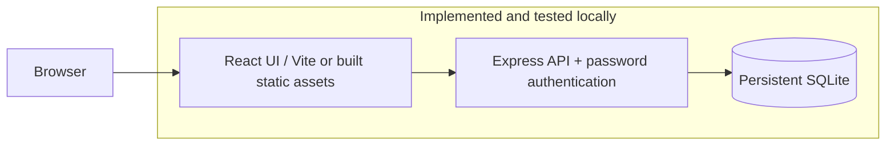
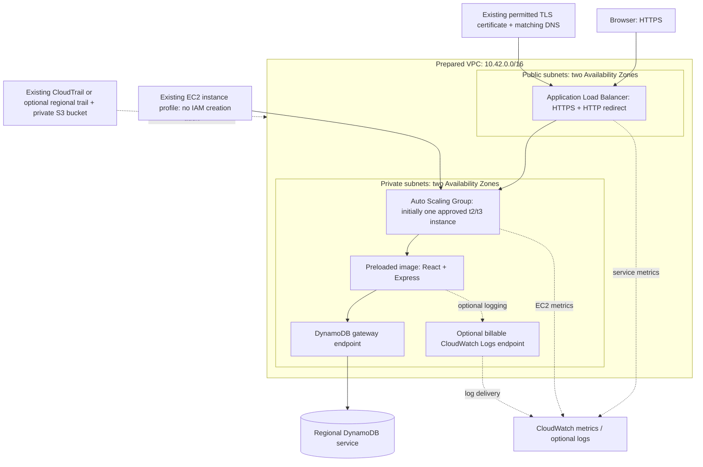

# Architecture and current implementation

**Status: local implementation only. No AWS account was connected and no cloud resources were created.**

Cloud Coordination Hub brings event registration, waitlists, polls, and office-hour reservations into one authenticated workspace. React/TypeScript/Vite serves a responsive interface; Express validates requests and enforces identity and ownership. One production image serves the built frontend and API, eliminating cross-origin deployment complexity. Local development proxies `/api` from Vite to Express.

## Networking and request flow

The internet-facing ALB spans public subnets `10.42.0.0/24` and `10.42.1.0/24`, with an Internet Gateway route. Private application subnets `10.42.10.0/24` and `10.42.11.0/24` have no default internet route and no public instance IPs. Only the ALB security group can reach EC2 port 3000; no SSH ingress is defined. HTTPS/HTTP audience ingress is a configurable approved IPv4 CIDR. HTTP redirects to HTTPS rather than accepting application credentials.

Browser → ALB TLS termination → private EC2 port 3000 → Express validation/authentication → DynamoDB via gateway endpoint → response. DynamoDB is **regional**, not an instance inside a private subnet. The endpoint policy limits operations to the application table; it does not grant permissions missing from the existing instance role. EC2 HTTPS egress is allowed, but there is no internet route: DynamoDB traffic follows the gateway endpoint, and optional Logs traffic follows its private interface endpoint. ALB-to-EC2 traffic is HTTP inside the restricted VPC; end-to-end TLS is a future improvement.

Private instances do not install software, pull from registries, reach GitHub, call SSM, or fetch secrets during startup. A prepared x86_64 Linux AMI contains Docker, the preloaded application image, and a systemd service. UserData writes nonsecret runtime configuration and starts that service. Deployment updates change the AMI and roll the ASG. This avoids NAT and ECR dependencies. Preparing that AMI later requires a separately approved builder or an instructor-provided suitable AMI. No image builder was launched now.

## Sandbox restrictions

| Restriction                           | Design response                                                                                                                                                                         |
| ------------------------------------- | --------------------------------------------------------------------------------------------------------------------------------------------------------------------------------------- |
| IAM read-only                         | Accept an existing instance-profile **name**. Create no roles, policies, or profiles. Attachment/PassRole and the existing role's service permissions must be verified later.           |
| Cognito not listed                    | Password authentication with scrypt, revocable database sessions, server-assigned roles, and backend ownership checks. No development login bypass.                                     |
| Approved t2/t3 only                   | Template allows a conservative t2/t3 selection, default t3.micro; verify actual account approval before execution.                                                                      |
| Maximum nine instances                | Capacity parameters capped at nine; account-wide existing/builder instances still count. Default desired one, maximum two.                                                              |
| No AWS connection now                 | SQLite default; AWS SDK credentials and endpoints are used only in explicitly selected local DynamoDB mode. AWS mode requires `ALLOW_AWS=true` and no local endpoint.                   |
| No assumed certificate service access | Existing permitted certificate and DNS are explicit deployment prerequisites. If unavailable, retain the secure local demonstration until the instructor supplies a permitted solution. |

## Security and observability

Application controls include password hashing, random 256-bit session tokens (hashed in storage), 8-hour expiry, HttpOnly/SameSite cookies, Secure cookies in production, explicit Origin checks on mutations including login (exact origin in production, known loopback UI ports in development), no permissive CORS, strict Zod schemas, request size/rate limits, CSV formula escaping, ownership checks, and safe error responses. Frontend registration always creates attendees; organizer provisioning uses the trusted CLI. Sessions and important data live in the selected database, not application memory. Production configuration rejects SQLite and an HTTP origin.

Infrastructure prepares IMDSv2, encrypted EBS, DynamoDB encryption and PITR, a table-scoped endpoint policy, restricted groups, and seven-day log retention. The existing role should have only the permissions documented in [deployment.md](deployment.md); this repository cannot change it. Network templates and policies are prepared, not cloud-verified.

Structured HTTP logs carry generated request IDs, path, status, and duration without passwords, cookies, body contents, or credentials. `/api/health` checks the process; `/api/ready` checks storage. CloudWatch's prepared dashboard tracks ALB latency/errors and EC2 CPU. CloudWatch monitors application/infrastructure behavior; CloudTrail audits AWS management API calls. The optional trail does not enable DynamoDB data-event auditing. No evidence of cloud log delivery exists yet. By default, Docker keeps bounded local logs; optional remote delivery needs both the cost-opted-in Logs endpoint and existing role permissions.

## Availability and limits

Cloud mode uses shared DynamoDB data and sessions, so a user can reach different instances without sticky sessions. Version checks resolve simultaneous mutations. Two instances across two AZs are the final availability target; desired one is a cost-conscious midpoint setting and is not highly available. The rolling-update configuration allows downtime at one instance. DynamoDB aggregate size/contention and collection-wide queries limit this prototype: see [database.md](../database.md). Rate limiting currently uses per-process counters; distributed abuse limits and benchmarking are final milestones.

React provides accessible labels, status messages, keyboard-modal behavior, responsive navigation, empty/loading states, and no hardcoded live dashboard metrics. Poll results come from persisted votes. Sample data is created only through an explicit local seed command and is labeled in demonstration evidence.

Technical references: [Node 24 SQLite](https://nodejs.org/docs/latest-v24.x/api/sqlite.html), [DynamoDB conditional expressions](https://docs.aws.amazon.com/amazondynamodb/latest/developerguide/Expressions.ConditionExpressions.html), [DynamoDB transactions](https://docs.aws.amazon.com/amazondynamodb/latest/developerguide/transaction-apis.html), and [CloudFormation Auto Scaling](https://docs.aws.amazon.com/AWSCloudFormation/latest/TemplateReference/aws-resource-autoscaling-autoscalinggroup.html).
